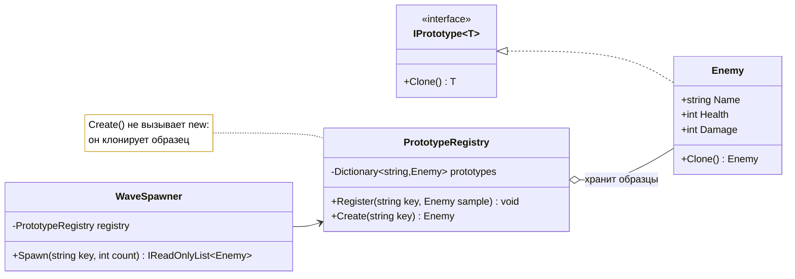

# Лабораторная работа 3. Прототип: создание копированием

!!! info "Об этом материале"

    Тема: паттерн Прототип — клонирование образца, глубокое копирование, реестр прототипов.
    Объём: 6–8 часов; сдаётся репозиторием с коммитами по этапам и отчётом.
    Оценка: 100 баллов плюс до 4 за задания со звёздочкой; штрафы указаны в тексте.


> Тема: порождающий паттерн Prototype — создание объектов клонированием образца, глубокое
> и поверхностное копирование, реестр прототипов. Язык — **C#** (Python по согласованию),
> диаграммы — **Mermaid**. Ориентировочно 6–8 часов.

## Цель работы

Научиться создавать объекты **копированием заготовки**, а не вызовом конструктора, и на
собственном коде увидеть обе стороны паттерна: как он убирает иерархию фабрик — и как
поверхностное копирование тихо ломает программу.

В лабораторной 1 выбор класса решала фабрика. Здесь выбора класса нет вообще: класс один,
а разные «виды» объектов — это разные **значения полей** у заранее заготовленных образцов.

## Легенда

Та же игра. Дизайнер уровней хочет сам заводить новые виды врагов: «возьми обычного
скелета, дай ему вдвое больше здоровья, щит и назови его „Стражем склепа“». Программист
при этом не должен писать ни одного нового класса — иначе каждый каприз дизайнера
превращается в релиз.

---

## Этап 0. Разминка: посчитать классы

Заготовка проекта лежит в материалах курса:
<https://github.com/radilov-spsu/materials/tree/main/OOP/examples/EnemyPrototypes> —
решение `EnemyPrototypes.sln`, консольное приложение, доменные классы и проект тестов
на xUnit. Как её забрать, написано там же в README. Скопируйте папку к себе, проверьте,
что `dotnet run` и `dotnet test` отрабатывают, — и это ваш первый коммит, до единой
собственной правки.

В заготовке лежит код, где каждый вид врага — отдельный класс:

```csharp
public sealed class Skeleton : Enemy       { /* Health = 60;  Damage = 8;  меч, доспех 5  */ }
public sealed class ArmoredSkeleton : Enemy { /* Health = 90;  Damage = 8;  доспех 25 + модификатор */ }
public sealed class SkeletonArcher : Enemy { /* Health = 50;  Damage = 12; лук, доспех 2  */ }
public sealed class CryptGuardian : Enemy  { /* Health = 120; Damage = 14; секира, доспех 30 */ }
public sealed class Ghoul : Enemy          { /* Health = 75;  Damage = 11; когти, доспех 8 */ }
// ...и так далее на каждый каприз дизайнера
```

Тело каждого конструктора — только присваивания: имя, числа, экипировка, список лута.
Ни одного переопределённого метода.

**Что сделать:**

1. Посчитать классы врагов в заготовке и выписать, **чем именно** они отличаются друг
   от друга. Отличия в поведении или только в числах?
2. Прикинуть, сколько классов появится, если дизайнер попросит ещё четыре варианта
   скелета и три варианта упыря.
3. Ответить письменно: почему фабричный метод из лабораторной 1 эту проблему **не решает**?
   (Подсказка: фабрика выбирает класс из тех, что уже есть; она не создаёт новые виды.)

---

## Этап 1. Клонирование и реестр прототипов (2 часа)

Оставьте **один** класс врага. Разные виды — это объекты-образцы с разными значениями
полей, которые умеют себя копировать.



??? note "Исходник диаграммы"

    ```
    classDiagram
        direction LR
        class IPrototype~T~ {
            <<interface>>
            +Clone() T
        }
        class Enemy {
            +string Name
            +int Health
            +int Damage
            +Clone() Enemy
        }
        class PrototypeRegistry {
            -Dictionary~string,Enemy~ prototypes
            +Register(string key, Enemy sample) void
            +Create(string key) Enemy
        }
        class WaveSpawner {
            -PrototypeRegistry registry
            +Spawn(string key, int count) IReadOnlyList~Enemy~
        }
        IPrototype~T~ <|.. Enemy
        PrototypeRegistry o-- Enemy : хранит образцы
        WaveSpawner --> PrototypeRegistry
        note for PrototypeRegistry "Create() не вызывает new:<br/>он клонирует образец"
    ```


```csharp
public sealed class Enemy
{
    public string Name { get; set; } = "";
    public int Health { get; set; }
    public int Damage { get; set; }
    public List<string> Loot { get; set; } = [];

    private Enemy(Enemy other)                 // копирующий конструктор
    {
        Name = other.Name;
        Health = other.Health;
        Damage = other.Damage;
        Loot = other.Loot;                     // ← внимание на эту строку, этап 2
    }

    public Enemy() { }

    public Enemy Clone() => new Enemy(this);
}
```

**Требования:**

- класс врага **один** (на вариант допускается два-три, если у них правда разное поведение);
- реестр прототипов: `Register("skeleton", sample)` и `Create("skeleton")`;
- спавнер работает только с реестром и не знает ни одного конкретного вида;
- тест: клон — **другой объект** (`ReferenceEquals` даёт `false`), но с теми же значениями;
- тест: изменение клона не меняет образец в реестре.

---

## Этап 2. Поверхностное против глубокого (2 часа)

Теперь ловим классическую ошибку. У врага есть список лута и набор эффектов — ссылочные
поля. Копирующий конструктор из этапа 1 копирует **ссылку**, а не содержимое.

**Порядок работы — сначала тест, потом исправление:**

1. Напишите падающий тест: склонировали двух скелетов, одному добавили предмет в лут —
   проверьте, что у второго лут не изменился. Зафиксируйте падение в отдельном коммите
   (`этап 2: тест, показывающий проблему поверхностного копирования`).
2. Исправьте клонирование на глубокое. Тест позеленел — второй коммит.
3. В отчёте объясните, почему баг **не проявляется сразу** и почему такие ошибки дорогие.

**Требования:**

- глубокое копирование для всех изменяемых ссылочных полей;
- отдельно подумайте про **неизменяемые** поля (строки, `record`-значения, перечисления):
  их копировать не нужно. В отчёте напишите, какие поля вы скопировали глубоко,
  а какие оставили как есть, и почему;
- минимум один вложенный уровень: у врага есть экипировка, у экипировки — список
  модификаторов. Проверьте тестом, что клонируются оба уровня.

⚠️ В отчёте отдельным абзацем: почему в C# не рекомендуют `ICloneable`. Ответ про то, что
интерфейс не определяет глубину копирования, должен быть вашими словами и с примером
из собственного кода.

---

## Этап 3. Прототипы из конфигурации (1,5 часа)

Главный выигрыш паттерна: новые виды **добавляются во время выполнения**, без единой
строки кода.

```json
[
  { "key": "skeleton",       "name": "Скелет",         "health": 60,  "damage": 8 },
  { "key": "crypt-guardian", "name": "Страж склепа",   "health": 120, "damage": 14,
    "loot": ["Ржавый щит"] }
]
```

**Требования:**

- реестр наполняется из JSON-файла при старте;
- добавление нового вида врага = правка файла, перекомпиляция не нужна. Продемонстрируйте
  это в отчёте: запуск до правки и после, один и тот же бинарник;
- обработка ошибок: неизвестный ключ в `Create` — внятное исключение, битый JSON — понятное
  сообщение.

**Вопрос в отчёт:** что вы потеряли, переехав из кода в конфигурацию? Нужен конкретный
ответ про то, какие ошибки раньше ловил компилятор, а теперь не ловит никто.

---

## Этап 4. Сравнение и выводы (1 час)

| | Фабричный метод (лаб. 1) | Абстрактная фабрика (лаб. 1) | Прототип (эта работа) |
|---|---|---|---|
| Что варьируется | | | |
| Сколько классов при 20 видах врагов | | | |
| Можно ли добавить вид в рантайме | | | |
| Что ловит компилятор | | | |
| Главная опасность | | | |

Отдельно ответьте: **в каком случае вы бы оставили фабрику, а не прототип?** Ответ
«прототип лучше» не принимается.

---

## Этап 5 (со звёздочкой)

+2 балла за пункт, максимум +4:

1. **`record` и `with`.** Сделайте неизменяемого врага-запись и создавайте варианты через
   `with`. Сравните с ручным клонированием: что стало проще, где потеряли контроль над
   глубиной копирования.
2. **Клонирование через сериализацию.** Реализуйте глубокую копию через `System.Text.Json`,
   замерьте время на 10 000 клонов и сравните с копирующим конструктором. Цифры в отчёт.
3. **Python-версия.** `copy.copy` против `copy.deepcopy`, собственный `__deepcopy__`.
   Покажите тот же баг с общим списком и то, как он лечится одной строкой.
4. **Прототип плюс приспособленец.** Неизменяемую часть врага (спрайт, описание, базовые
   характеристики) сделайте разделяемой между всеми клонами, изменяемую — копируемой.
   Замерьте память до и после.

---

## Варианты заданий

Вселенная — та же, что в лабораторных 1–2. Различается клонируемая сущность и вложенная
структура:

| № | Что клонируем | Вложенный уровень |
|---|---|---|
| 1 | враг | экипировка → модификаторы |
| 2 | корабль | отсеки → системы |
| 3 | противник | импланты → эффекты |
| 4 | судно | команда → роли |
| 5 | мутант | мутации → параметры |
| 6 | автоматон | механизмы → детали |
| 7 | юнит осады | снаряжение → усиления |
| 8 | существо | симбионты → свойства |
| 9 | угроза | снаряжение → слои защиты |
| 10 | существо мифа | дары → эффекты |
| 11 | заражённый | стадии заражения → симптомы |
| 12 | согласовать | согласовать |

---

## Что сдаётся

1. **Репозиторий** на основе [заготовки](https://github.com/radilov-spsu/materials/tree/main/OOP/examples/EnemyPrototypes), коммиты по этапам; для этапа 2 —
   **два** коммита: падающий тест и исправление.
2. **Код**: консольное приложение спавнит волну из прототипов, загруженных из JSON.
3. **Тесты** — минимум шесть: клон не тот же объект; значения совпадают; правка клона
   не трогает образец; поверхностное копирование поймано (тест этапа 2); вложенный уровень
   клонируется; неизвестный ключ даёт исключение.
4. **Отчёт** `README.md`: ответы на вопросы этапов 0–4, диаграмма классов в Mermaid,
   таблица сравнения, раздел «чем платим», демонстрация добавления вида через конфиг.

---

## Критерии оценки

| Что | Баллов |
|---|---|
| Этап 0: подсчёт классов и ответ про фабрику | 5 |
| Этап 1: клонирование и реестр прототипов | 25 |
| Этап 2: глубокое копирование, два коммита, разбор `ICloneable` | 25 |
| Этап 3: прототипы из конфигурации, обработка ошибок | 15 |
| Тесты (6 обязательных) | 15 |
| Диаграмма и отчёт | 15 |
| **Итого** | **100** |
| Этап 5 со звёздочкой | +2 за пункт, максимум +4 |

**Штрафы:** подклассы вместо прототипов — минус 15; поверхностное копирование без теста —
минус 10; один коммит на этап 2 — минус 5; `ICloneable` без объяснения глубины копирования —
минус 5.

---

## Типичные ошибки

1. **Прототип остался иерархией.** Классы никуда не делись, к ним просто добавили `Clone()`.
2. **Клон делится состоянием с образцом.** Самая частая и самая коварная: программа
   работает, пока никто ничего не меняет.
3. **Глубокое копирование всего подряд.** Строки и неизменяемые значения копировать
   не нужно — это трата времени и памяти.
4. **Циклические ссылки.** Враг ссылается на отряд, отряд — на врагов; наивное глубокое
   копирование уходит в бесконечность. Если в вашей модели такое есть — покажите, как решили.
5. **Реестр как глобальная переменная.** Статический реестр, доступный отовсюду, — это уже
   следующая лабораторная, и там мы увидим, чем он плох.

---

## Контрольные вопросы

1. Чем прототип принципиально отличается от фабрики? Что он позволяет такого, чего
   не может фабричный метод?
2. Поверхностное и глубокое копирование: покажите на своём коде, где проходит граница.
3. Какие поля не нужно копировать глубоко и почему?
4. Почему `ICloneable` считается неудачным интерфейсом?
5. Что вы потеряли, перенеся описание видов в JSON?
6. Как клонировать объект с циклическими ссылками?

## Литература

- Конспект лекции 5, блок 7 «Prototype — прототип».
- **Э. Гамма и др. Приёмы объектно-ориентированного проектирования**, глава 3, раздел
  «Прототип»: пример с палитрой инструментов графического редактора и разбор того,
  почему клонирование — самая сложная часть паттерна.
- Документация .NET: `MemberwiseClone`, рекомендации по `ICloneable`, `record` и `with`.
