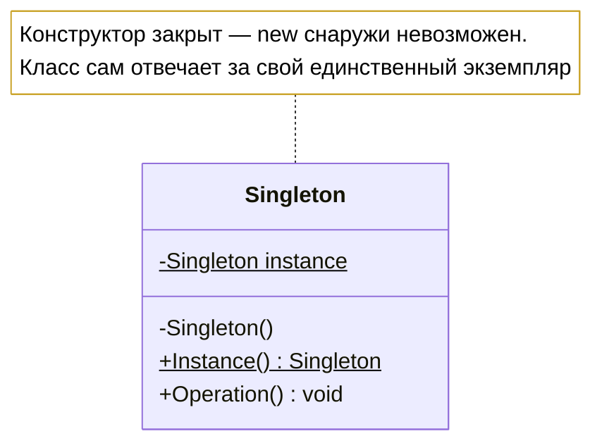
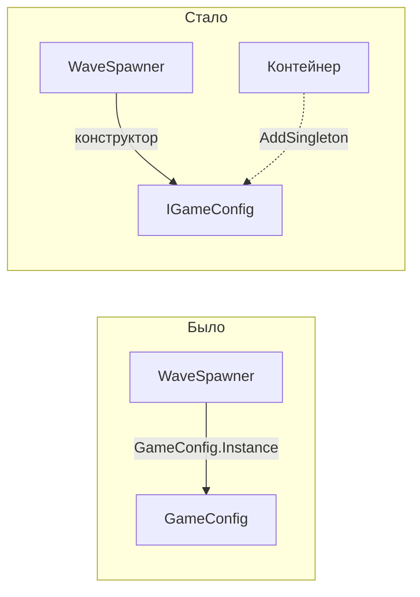

# Лабораторная работа 4. Одиночка: как его пишут и почему от него уходят

!!! info "Об этом материале"

    Тема: паттерн Одиночка — корректные реализации, потокобезопасность и переход к управлению временем жизни через контейнер.
    Объём: 6–8 часов; сдаётся репозиторием с коммитами по этапам и отчётом.
    Оценка: 100 баллов плюс до 4 за задания со звёздочкой; штрафы указаны в тексте.


> Тема: порождающий паттерн Singleton — корректные реализации, потокобезопасность,
> и главное: чем он плох и как единственность обеспечивают сегодня. Язык — **C#**,
> диаграммы — **Mermaid**. Ориентировочно 6–8 часов.

## Цель работы

Реализовать одиночку правильно — и **на собственных падающих тестах** увидеть, почему
этот паттерн называют самым злоупотребляемым в каталоге. К концу работы вы должны уметь
защитить оба решения: и применение одиночки, и отказ от него в пользу контейнера.

Работа устроена иначе, чем предыдущие три. Там мы шли от плохого кода к паттерну.
Здесь сначала напишем паттерн **правильно**, а потом будем от него уходить — и это
не противоречие, а честная картина: единственность нужна, а глобальная точка доступа —
почти никогда.

## Легенда

Игра из прошлых лабораторных обросла инфраструктурой. Есть вещи, которых должно быть
ровно по одной штуке:

- **настройки игры** — читаются при старте, дальше только читаются;
- **журнал событий** — пишет в консоль и файл;
- **менеджер сохранений** — держит открытый файл сохранения.

Классический повод достать одиночку. Посмотрим, во что это обойдётся.

---

## Этап 0. Наивный одиночка и гонка (1 час)

Заготовка проекта лежит в материалах курса:
<https://github.com/radilov-spsu/materials/tree/main/OOP/examples/GameSingleton> —
решение `GameSingleton.sln`, консольное приложение, доменные классы и проект тестов
на xUnit. Как её забрать, написано там же в README. Скопируйте папку к себе, проверьте,
что `dotnet run` и `dotnet test` отрабатывают, — и это ваш первый коммит, до единой
собственной правки.

В заготовке лежит реализация «как в интернете»:

```csharp
public class GameConfig
{
    private static GameConfig? _instance;

    public static GameConfig Instance
    {
        get
        {
            if (_instance is null)              // ← два потока могут войти сюда одновременно
            {
                Thread.Sleep(10);               // имитация долгой загрузки настроек
                _instance = new GameConfig();
            }
            return _instance;
        }
    }

    public Guid Id { get; } = Guid.NewGuid();   // чтобы различать экземпляры
    private GameConfig() { }
}
```

**Что сделать:**

1. Написать тест, который запускает 50 потоков, одновременно читающих `Instance`,
   и собирает все полученные `Id` в множество. Ожидание — один уникальный `Id`.
   **Тест должен упасть.** Зафиксировать падение отдельным коммитом.
2. В отчёте: сколько разных экземпляров получилось в вашем запуске; почему число
   нестабильно от запуска к запуску; что произойдёт в реальной игре, если так
   «размножится» менеджер сохранений.
3. Ответить: почему `Thread.Sleep` в примере делает баг воспроизводимым, а без него
   он проявляется раз в тысячу запусков? Это и есть ответ на вопрос, почему такие
   ошибки доживают до продакшена.

---

## Этап 1. Три корректные реализации (2 часа)

Реализуйте **три** варианта и сравните их.



??? note "Исходник диаграммы"

    ```
    classDiagram
        class Singleton {
            -Singleton instance$
            -Singleton()
            +Instance() Singleton$
            +Operation() void
        }
        note for Singleton "Конструктор закрыт — new снаружи невозможен.<br/>Класс сам отвечает за свой единственный экземпляр"
    ```


**1. Статическое поле только для чтения** — инициализация при первом обращении к типу:

```csharp
public sealed class GameConfig
{
    private static readonly GameConfig _instance = new();
    public static GameConfig Instance => _instance;
    private GameConfig() { }
}
```

**2. `Lazy<T>`** — ленивая и потокобезопасная по умолчанию:

```csharp
public sealed class GameConfig
{
    private static readonly Lazy<GameConfig> _lazy = new(() => new GameConfig());
    public static GameConfig Instance => _lazy.Value;
    private GameConfig() { }
}
```

**3. Двойная проверка блокировки** — руками, чтобы понимать, что делает `Lazy<T>`:

```csharp
public sealed class GameConfig
{
    private static volatile GameConfig? _instance;      // volatile здесь обязателен
    private static readonly object _gate = new();

    public static GameConfig Instance
    {
        get
        {
            if (_instance is null)                      // быстрая проверка без блокировки
            {
                lock (_gate)
                {
                    if (_instance is null)              // повторная — под блокировкой
                        _instance = new GameConfig();
                }
            }
            return _instance;
        }
    }

    private GameConfig() { }
}
```

**Требования:**

- тест из этапа 0 проходит для **всех трёх** реализаций (параметризуйте его);
- в отчёте таблица: когда создаётся экземпляр, нужна ли блокировка при каждом чтении,
  что произойдёт, если убрать `volatile`, что произойдёт, если убрать вторую проверку;
- ответить, почему во всех трёх вариантах конструктор приватный и класс `sealed`.

**Разберитесь отдельно** (это вопрос на защите): в чём разница между
`new Lazy<T>(factory)` и `new Lazy<T>(factory, LazyThreadSafetyMode.PublicationOnly)`,
и что происходит, если фабрика бросает исключение.

---

## Этап 2. Почему от него уходят: падающие тесты (2 часа)

Самая важная часть работы. Здесь одиночка показывает свою цену.

Добавьте в `GameConfig` изменяемое состояние — например, громкость, сложность, язык —
и используйте конфигурацию в игровой логике: `WaveSpawner` берёт из неё множитель
сложности.

**Напишите три теста, которые покажут проблему:**

1. **Тесты влияют друг на друга.** Первый тест ставит сложность «кошмар» и проверяет
   усиленную волну. Второй ожидает обычную волну — и падает, потому что состояние
   осталось от первого. Докажите, что результат зависит от **порядка** выполнения тестов.
2. **Зависимость не видна в сигнатуре.** Покажите класс, который лезет в
   `GameConfig.Instance` изнутри метода. По его конструктору и сигнатурам невозможно
   понять, что он зависит от конфигурации. Опишите, как это мешает читать чужой код.
3. **Подменить нечем.** Попробуйте в тесте подсунуть другую конфигурацию. Опишите,
   что для этого пришлось бы сделать (публичный сеттер `Instance`, метод `Reset`) и
   почему это лечение хуже болезни.

**В отчёт:** три абзаца — по одному на каждую проблему, своими словами, со ссылками
на собственные тесты. Это самый весомый пункт в критериях.

---

## Этап 3. Единственность без одиночки (1,5 часа)

Переносим ответственность за жизненный цикл туда, где ей место.



??? note "Исходник диаграммы"

    ```
    flowchart LR
        subgraph "Было"
            A[WaveSpawner] -->|GameConfig.Instance| B[GameConfig]
        end
        subgraph "Стало"
            C[WaveSpawner] -->|конструктор| D[IGameConfig]
            E[Контейнер] -.->|AddSingleton| D
        end
    ```


```csharp
public interface IGameConfig
{
    int DifficultyMultiplier { get; }
    string Language { get; }
}

public sealed class GameConfig : IGameConfig { /* обычный класс, конструктор публичный */ }

// Единственность — требование к жизненному циклу, и отвечает за неё контейнер
services.AddSingleton<IGameConfig, GameConfig>();

public sealed class WaveSpawner
{
    private readonly IGameConfig _config;
    public WaveSpawner(IGameConfig config) => _config = config;   // зависимость видна
}
```

**Требования:**

- интерфейс для каждой из трёх «единственных» сущностей;
- регистрация в `Microsoft.Extensions.DependencyInjection` со временем жизни `Singleton`;
- **тесты из этапа 2 переписаны и теперь зелёные**: у каждого теста своя конфигурация,
  порядок выполнения ни на что не влияет;
- тест, доказывающий, что контейнер действительно отдаёт один и тот же экземпляр
  (`ReferenceEquals` для двух запросов).

**Вопрос в отчёт:** что именно изменилось? Экземпляр по-прежнему один — почему же тесты
стали независимыми? Ответ должен быть про то, **кто** решает, сколько экземпляров
существует, и **откуда** объект получает зависимость.

---

## Этап 4. Сравнение и границы (1 час)

Заполните таблицу по своему коду:

| Критерий | Одиночка | Статический класс | Singleton-время жизни в контейнере |
|---|---|---|---|
| Реализует интерфейс | | | |
| Подменяется в тестах | | | |
| Зависимость видна в конструкторе | | | |
| Кто управляет временем жизни | | | |
| Ленивая инициализация | | | |
| Поведение при параллельных тестах | | | |

И ответьте на два вопроса:

1. **Когда одиночка всё-таки оправдан?** Приведите конкретный случай из своего кода
   или из .NET, где он уместен, и объясните, чем этот случай отличается от конфигурации
   из этапа 2. (Ориентир: неизменяемое состояние, отсутствие ввода-вывода, нет нужды
   подменять в тестах.)
2. Назначение паттерна у GoF состоит из **двух** частей: единственный экземпляр
   и глобальная точка доступа. Какую из частей отбрасывает современная практика и почему?

---

## Этап 5 (со звёздочкой)

+2 балла за пункт, максимум +4:

1. **Python.** Единственность через `__new__`, через декоратор и через модуль
   (модуль импортируется один раз и сам является одиночкой). Какой вариант идиоматичен
   и почему в Python эта проблема вообще стоит менее остро.
2. **Monostate.** Реализуйте «моносостояние»: экземпляров сколько угодно, состояние общее
   (статические поля за обычными свойствами). Сравните с одиночкой: что лучше для тестов,
   что хуже для понимания кода.
3. **Времена жизни.** Покажите в одном приложении разницу `Singleton`, `Scoped` и
   `Transient`: тест, в котором видно, сколько экземпляров создаётся в каждом случае.
4. **Ленивость с ошибкой.** Сделайте фабрику `Lazy<T>`, которая бросает исключение
   при первом вызове. Покажите тестом, что исключение кешируется и повторная попытка
   не помогает, и объясните, чем это опасно для загрузки настроек по сети.

---

## Варианты заданий

Вселенная — та же. Различается набор «единственных» сущностей:

| № | Сущности-одиночки | Изменяемое состояние для этапа 2 |
|---|---|---|
| 1 | настройки, журнал, менеджер сохранений | множитель сложности |
| 2 | конфигурация флота, телеметрия, реестр доков | уровень тревоги |
| 3 | профиль импланта, журнал взломов, кеш сети | уровень шума |
| 4 | карта течений, судовой журнал, порт приписки | погода |
| 5 | уровень радиации, журнал вылазок, схрон | уровень радиации |
| 6 | давление пара, журнал цеха, склад деталей | давление в системе |
| 7 | запасы осады, журнал приказов, арсенал | боевой дух |
| 8 | глубина, журнал погружений, кислород | глубина |
| 9 | погода, журнал экспедиции, запасы | температура |
| 10 | благосклонность богов, хроника, пантеон | благосклонность |
| 11 | уровень заражения, журнал, аптечка лагеря | уровень заражения |
| 12 | согласовать | согласовать |

---

## Что сдаётся

1. **Репозиторий** на основе [заготовки](https://github.com/radilov-spsu/materials/tree/main/OOP/examples/GameSingleton). Коммиты по этапам; для этапа 0 —
   отдельный коммит с падающим тестом (он должен остаться в истории).
2. **Код**: три реализации одиночки, многопоточный тест, версия на контейнере.
3. **Тесты** — минимум семь: многопоточный тест для трёх реализаций; три теста этапа 2,
   показывающие проблемы; тесты этапа 3, доказывающие независимость и единственность
   экземпляра.
4. **Отчёт** `README.md`: ответы на вопросы всех этапов, обе таблицы, диаграмма,
   и обязательный раздел «когда одиночка оправдан» с конкретным примером.

---

## Критерии оценки

| Что | Баллов |
|---|---|
| Этап 0: падающий многопоточный тест и разбор гонки | 10 |
| Этап 1: три реализации, таблица сравнения, `volatile` и двойная проверка | 20 |
| Этап 2: три проблемы, показанные **падающими тестами** | 30 |
| Этап 3: переход на контейнер, тесты стали независимыми | 20 |
| Диаграммы и отчёт | 10 |
| Ответ «когда одиночка оправдан» с конкретным примером | 10 |
| **Итого** | **100** |
| Этап 5 со звёздочкой | +2 за пункт, максимум +4 |

**Штрафы:** этап 2 описан словами без тестов — минус 15; падающий тест этапа 0 затёрт
из истории — минус 5; `Reset()` или публичный сеттер `Instance` как «решение» проблемы
тестов — минус 10; одиночка оставлен в итоговом коде без обоснования — минус 10.

---

## Типичные ошибки

1. **`Reset()` ради тестов.** Метод, который обнуляет экземпляр между тестами, — это
   признание, что паттерн выбран неверно. Плюс он ломается при параллельном запуске.
2. **`lock` при каждом обращении.** Корректно, но блокировка на горячем пути ради
   инициализации, которая случается один раз.
3. **Потеря `volatile` в двойной проверке.** Работает на x86 и ломается на ARM —
   отличный повод рассказать про модель памяти.
4. **Одиночка с вводом-выводом.** Класс, который в конструкторе лезет в сеть или файл,
   превращает каждый тест в интеграционный.
5. **Статический класс вместо интерфейса.** Подменить нечем, зависимость невидима —
   все минусы одиночки без его единственного плюса.
6. **«Мы просто не будем менять состояние».** Договорённость, которую нарушит первый же
   новый человек в команде. Инвариант должен держать код, а не обещание.

---

## Контрольные вопросы

1. Почему наивная проверка `if (_instance is null)` не потокобезопасна? Нарисуйте
   последовательность действий двух потоков.
2. Зачем нужна **вторая** проверка в двойной проверке блокировки?
3. Что делает `volatile` и почему без него двойная проверка некорректна?
4. Чем одиночка отличается от статического класса? Назовите три различия.
5. Почему тесты, использующие одиночку, зависят от порядка выполнения?
6. Экземпляр один и там, и там — почему версия с контейнером тестируется, а версия
   с одиночкой нет?
7. Приведите случай, когда одиночка — правильный выбор.

## Литература

- Конспект лекции 5, блок 8 «Singleton — одиночка», включая таблицу сравнения
  со статическим классом.
- **Э. Гамма и др. Приёмы объектно-ориентированного проектирования**, глава 3, раздел
  «Одиночка»: обратите внимание на формулировку назначения из двух частей.
- **Э. Фримен, Э. Фримен. Паттерны проектирования**, глава 5 — та же тема с разбором
  многопоточности по шагам.
- Документация .NET: `Lazy<T>`, `LazyThreadSafetyMode`, времена жизни в
  `Microsoft.Extensions.DependencyInjection`.
