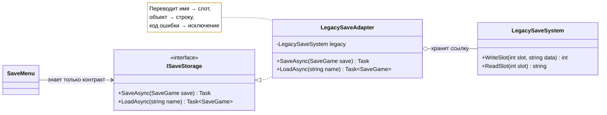
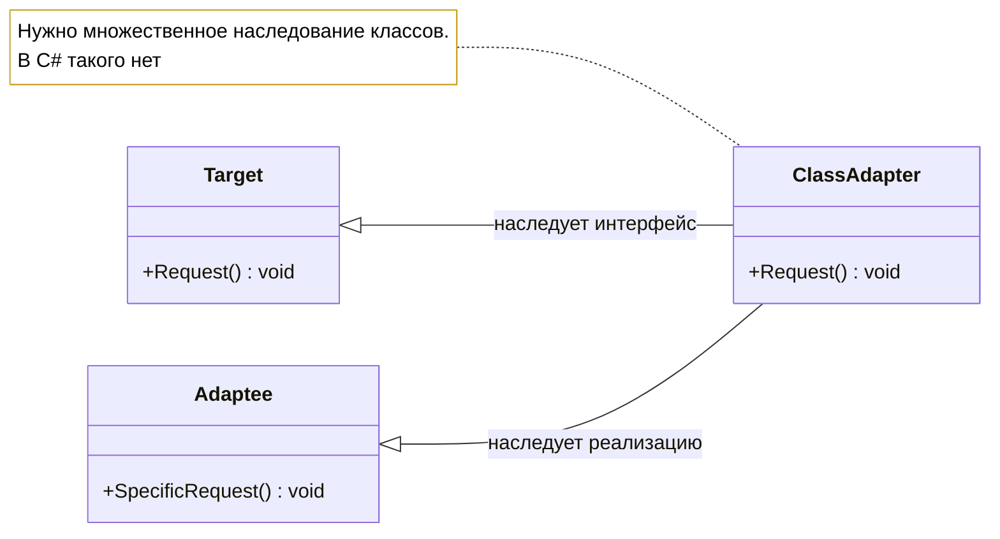

# Лабораторная работа 5. Адаптер: подружить несовместимое

!!! info "Об этом материале"

    Тема: структурный паттерн Адаптер — две схемы GoF, перевод имён, данных, протокола ошибок и модели асинхронности.
    Объём: 6–8 часов; сдаётся репозиторием с коммитами по этапам и отчётом.
    Оценка: 100 баллов плюс до 4 за задания со звёздочкой; штрафы указаны в тексте.

> Тема: структурный паттерн Adapter — две схемы GoF, преобразование не только имён,
> но и данных и протокола ошибок. Язык — **C#** (классовый адаптер — на **Python**),
> диаграммы — **Mermaid**. Ориентировочно 6–8 часов.

## Цель работы

Научиться подключать к своему коду чужие библиотеки, которые нельзя изменить, не пуская
их интерфейс дальше границы системы. И на собственном коде увидеть обе схемы паттерна:
адаптер объектов и адаптер классов — вместе с тем, почему вторая в C# не выражается.

Это первая структурная лабораторная. В лабораторных 1–4 мы решали, **как создать** объект.
Здесь объекты уже созданы кем-то другим, и вопрос в том, **как с ними разговаривать**.

## Легенда

Игра выходит на новые платформы, и ей нужны сохранения. В проекте уже есть свой контракт:

```csharp
public interface ISaveStorage
{
    Task SaveAsync(SaveGame save, CancellationToken ct = default);
    Task<SaveGame?> LoadAsync(string name, CancellationToken ct = default);
    Task<IReadOnlyList<string>> ListAsync(CancellationToken ct = default);
}
```

А снаружи есть два хранилища, **исходники которых менять нельзя** (в заготовке они помечены
`// ЧУЖОЙ КОД — НЕ МЕНЯТЬ`):

- **`LegacySaveSystem`** — наш же код десятилетней давности: синхронный, работает со слотами
  по номеру, хранит плоскую строку, об ошибках сообщает **кодами возврата**;
- **`CloudStorageSdk`** — сторонний SDK: работает с массивами байтов, асинхронный **через
  коллбэки**, ключи строковые, ошибки — в коде статуса внутри коллбэка.

Задача: игра не должна знать ни про слоты, ни про коды возврата, ни про коллбэки.

---

## Этап 0. Разминка: найти размазанную адаптацию (30 минут)

Заготовка проекта лежит в материалах курса:
<https://github.com/radilov-spsu/materials/tree/main/OOP/examples/SaveAdapters> —
решение `SaveAdapters.sln`, консольное приложение, чужой код в папке `Foreign/`,
проект тестов на xUnit и папка `python/` для этапа 3. Как её забрать, написано там же
в README. Скопируйте папку к себе, проверьте, что `dotnet run` и `dotnet test`
отрабатывают, — и это ваш первый коммит, до единой собственной правки.

В заготовке лежит `SaveMenu`, который работает с легаси-системой напрямую:

```csharp
public class SaveMenu
{
    private readonly LegacySaveSystem _legacy = new();

    public void Save(SaveGame save)
    {
        var raw = $"{save.PlayerName}|{save.Level}|{save.Health}";   // сериализация прямо здесь
        var code = _legacy.WriteSlot(SlotOf(save.Name), raw);

        if (code == LegacySaveSystem.ErrDiskFull) Console.WriteLine("Нет места");
        else if (code == LegacySaveSystem.ErrLocked) Console.WriteLine("Слот занят");
        else if (code != LegacySaveSystem.Ok) Console.WriteLine("Неизвестная ошибка");
    }

    // ...и такие же куски в LoadMenu, в автосохранении, в экране настроек
}
```

**Что сделать:**

1. Найти в заготовке **все** места, где игровой код знает о деталях легаси-системы:
   номера слотов, формат строки, коды ошибок. Выписать списком с номерами строк.
2. Прикинуть, что придётся изменить при подключении облачного SDK: сколько файлов,
   сколько мест.
3. Ответить письменно: это нарушение какого принципа из лекции 2? Назовите запах кода
   из каталога, который здесь виден невооружённым глазом.

---

## Этап 1. Адаптер объектов (2 часа)

Заверните легаси-систему в адаптер, реализующий `ISaveStorage`.



??? note "Исходник диаграммы"

    ```
    classDiagram
        direction LR
        class ISaveStorage {
            <<interface>>
            +SaveAsync(SaveGame save) Task
            +LoadAsync(string name) Task~SaveGame~
        }
        class LegacySaveAdapter {
            -LegacySaveSystem legacy
            +SaveAsync(SaveGame save) Task
            +LoadAsync(string name) Task~SaveGame~
        }
        class LegacySaveSystem {
            +WriteSlot(int slot, string data) int
            +ReadSlot(int slot) string
        }
        class SaveMenu
        ISaveStorage <|.. LegacySaveAdapter
        LegacySaveAdapter o-- LegacySaveSystem : хранит ссылку
        SaveMenu --> ISaveStorage : знает только контракт
        note for LegacySaveAdapter "Переводит имя → слот,<br/>объект → строку,<br/>код ошибки → исключение"
    ```

**Требования:**

- `SaveMenu` и весь игровой код зависят **только** от `ISaveStorage`;
- адаптер переводит четыре вещи, а не одну:
  1. **имена операций** (`WriteSlot` → `SaveAsync`),
  2. **данные** (`SaveGame` ↔ плоская строка),
  3. **адресацию** (имя сохранения ↔ номер слота),
  4. **протокол ошибок** (коды возврата → исключения предметной области);
- ни одного упоминания `LegacySaveSystem` за пределами адаптера — проверяется поиском
  по проекту;
- тесты: успешное сохранение и загрузка; каждый код ошибки превращается в своё исключение.

**В отчёт:** в книге адаптер описан как преобразование интерфейса. Ваш адаптер делает
больше — перечислите, что именно, и объясните, почему это по-прежнему адаптер,
а не что-то другое.

---

## Этап 2. Второй адаптер: другой вид несовместимости (2 часа)

Теперь облачный SDK. Он несовместим **иначе**: не просто другие имена, а другой стиль
вызова.

```csharp
// ЧУЖОЙ КОД — НЕ МЕНЯТЬ
public sealed class CloudStorageSdk
{
    public void Upload(string key, byte[] payload, Action<int> onComplete) { }
    public void Download(string key, Action<int, byte[]?> onComplete) { }
    public void ListKeys(Action<int, string[]> onComplete) { }
}
```

**Требования:**

- адаптер превращает коллбэки в `Task` (ориентир: `TaskCompletionSource`);
- поддержан `CancellationToken` — хотя бы отменой ожидания;
- статус-код из коллбэка превращается в исключение, как и на этапе 1;
- **тот же набор тестов прогоняется против обоих адаптеров.** Оформите их как `[Theory]`
  с источником данных из двух реализаций. Это главное доказательство работы паттерна:
  тесты написаны против контракта и не знают, кого проверяют.

**Вопрос в отчёт:** назовите три вида несовместимости, которые вы устранили в двух
адаптерах (имена, данные, адресация, ошибки, стиль вызова — выберите и обоснуйте).
Почему подключение третьего хранилища теперь не затронет игровой код?

---

## Этап 3. Адаптер классов и почему его нет в C# (1 час)

GoF описывает **две** схемы. Этап 1 был адаптером объектов — он хранит ссылку. Адаптер
классов наследует одновременно и `Target`, и `Adaptee`.



??? note "Исходник диаграммы"

    ```
    classDiagram
        direction LR
        class Target {
            +Request() void
        }
        class Adaptee {
            +SpecificRequest() void
        }
        class ClassAdapter {
            +Request() void
        }
        Target <|-- ClassAdapter : наследует интерфейс
        Adaptee <|-- ClassAdapter : наследует реализацию
        note for ClassAdapter "Нужно множественное наследование классов.<br/>В C# такого нет"
    ```

**Требования:**

1. Реализовать адаптер классов на **Python** — там множественное наследование есть,
   и схема пишется ровно так, как нарисована.
2. Попробовать выразить её в C# и зафиксировать в отчёте, что получилось: при каком
   условии остаётся урезанная форма и чего в ней не хватает по сравнению со схемой GoF.
3. Сравнить последствия: какой адаптер работает с подклассами `Adaptee`, а какой может
   переопределить его поведение. Подтвердить вывод кодом — в Python это проверяется
   одним тестом.

**В отчёт:** одна фраза, которую вы скажете на защите: в адаптере объектов адаптер
`____` чужой объект, в адаптере классов — `____` им. (Заполните и объясните, почему
из этого следует разница из пункта 3.)

---

## Этап 4. Соседи по форме (1 час)

У адаптера, фасада, декоратора и заместителя похожие диаграммы. Различаются они намерением.

Заполните таблицу по **своему** коду — каждую строку подкрепите ссылкой на класс
из ваших лабораторных 1–5 или на класс из .NET:

| | Что делает с обёрнутым объектом | Меняет ли интерфейс | Пример из моего кода / .NET |
|---|---|---|---|
| Адаптер | | | |
| Фасад | | | |
| Декоратор | | | |
| Заместитель | | | |

И ответьте на два вопроса:

1. **Адаптер против моста.** Оба соединяют два мира. В чём разница по **времени**
   принятия решения? (Ответ понадобится в следующей лабораторной — там мы будем строить мост.)
2. Если бы `ISaveStorage` проектировался **одновременно** с хранилищами, а не поверх
   готовых, — был бы это адаптер? Как бы он тогда назывался?

---

## Этап 5 (со звёздочкой)

+2 балла за пункт, максимум +4:

1. **Двусторонний адаптер.** GoF упоминает адаптер, прозрачный для обеих сторон: его можно
   подставить и туда, где ждут `Target`, и туда, где ждут `Adaptee`. Реализуйте и покажите
   тестом оба применения.
2. **Адаптер на методах расширения.** Для случая, когда `Target` — это один метод,
   обёртка не нужна: достаточно `public static ... this`. Покажите, где это уместно,
   а где ломается (подсказка: подмена в тестах).
3. **Утиная типизация вместо адаптера.** Покажите на Python и на `foreach` в C#, как язык
   иногда делает адаптер ненужным. Объясните, какую гарантию вы при этом теряете.
4. **Адаптер поверх генерации.** Сгенерируйте обёртку исходным генератором или
   `DispatchProxy` вместо ручного написания методов. Сравните с версией, написанной руками.

---

## Варианты заданий

Вселенная — та же, что в лабораторных 1–4. Различаются две «чужие» системы:

| № | Контракт игры | Чужая система 1 (коды ошибок) | Чужая система 2 (коллбэки) |
|---|---|---|---|
| 1 | хранилище сохранений | легаси-слоты | облачный SDK |
| 2 | журнал телеметрии | бортовой самописец | аналитика издателя |
| 3 | хранилище профилей | локальный реестр | сервис синхронизации |
| 4 | судовой журнал | бумажная книга (файл) | портовая сеть |
| 5 | склад припасов | инвентарь на CSV | обменник выживших |
| 6 | учёт деталей | перфокарты (файл) | телеграф снабжения |
| 7 | журнал осады | свиток приказов | гонец (асинхронный) |
| 8 | дневник погружений | бортовой журнал | буй связи |
| 9 | журнал экспедиции | полевые записи | спутниковый канал |
| 10 | хроника деяний | каменные скрижали | оракул (асинхронный) |
| 11 | карта убежищ | бумажная карта | радиосеть выживших |
| 12 | согласовать | согласовать | согласовать |

Структура у всех одинаковая: синхронная система с кодами ошибок и асинхронная
с коллбэками.

---

## Что сдаётся

1. **Репозиторий** на основе [заготовки](https://github.com/radilov-spsu/materials/tree/main/OOP/examples/SaveAdapters), коммиты по этапам.
2. **Код**: приложение сохраняет и загружает через оба адаптера, выбор — одной строкой
   при сборке.
3. **Тесты** — минимум шесть: сохранение и загрузка (общие для обоих адаптеров через
   `[Theory]`); каждый код ошибки легаси превращается в своё исключение; ошибка облака
   превращается в исключение; отмена по `CancellationToken`; список сохранений.
4. **Отчёт** `README.md`: ответы на вопросы этапов 0–4, диаграмма классов для обоих
   адаптеров, таблица «соседи по форме», раздел «чем платим».
5. **Python-часть** этапа 3 — отдельной папкой `python/` с тестом.

---

## Критерии оценки

| Что | Баллов |
|---|---|
| Этап 0: найденные места размазанной адаптации, принцип и запах | 5 |
| Этап 1: адаптер объектов, четыре вида перевода, изоляция чужого типа | 25 |
| Этап 2: адаптер над коллбэками, `Task`, общие тесты через `[Theory]` | 25 |
| Этап 3: адаптер классов на Python и разбор ограничения C# | 15 |
| Тесты (6 обязательных) | 15 |
| Диаграммы и отчёт, включая таблицу «соседи по форме» | 15 |
| **Итого** | **100** |
| Этап 5 со звёздочкой | +2 за пункт, максимум +4 |

**Штрафы:** упоминание чужого типа вне адаптера — минус 10; коды ошибок, протекшие
в игровой код, — минус 10; отдельные наборы тестов вместо общего `[Theory]` — минус 5;
правка файлов с пометкой «ЧУЖОЙ КОД» — минус 15.

---

## Типичные ошибки

1. **Адаптер только переименовывает.** Данные и ошибки остались чужими — игра по-прежнему
   знает про коды возврата, просто называет их иначе.
2. **Тип чужой библиотеки в сигнатуре адаптера.** `Task<LegacyRecord> LoadAsync(...)` —
   изоляции нет, адаптер протекает.
3. **`Task.Run` вокруг синхронного вызова** и объявление этого «асинхронностью».
   В отчёте объясните, чем это отличается от настоящей асинхронности SDK.
4. **Коллбэк, обёрнутый в `.Result` или `.Wait()`.** Блокировка потока и потенциальный
   дедлок — ровно та ошибка, ради которой существует `TaskCompletionSource`.
5. **Адаптер с собственной бизнес-логикой.** Если внутри появились правила предметной
   области — это уже не адаптер; назовите честно.
6. **Два набора одинаковых тестов.** Копипаста вместо `[Theory]` — признак того, что
   смысл контракта не понят.

---

## Контрольные вопросы

1. Какие две схемы адаптера описывает GoF и чем они отличаются?
2. Почему адаптер классов не выражается в C# и что остаётся вместо него?
3. Какой адаптер работает с подклассами `Adaptee`, а какой может переопределять
   его поведение? Почему?
4. Чем адаптер отличается от фасада? А от декоратора?
5. Адаптер меняет не только имена — что ещё он у вас переводит?
6. Чем адаптер отличается от моста по времени принятия решения?

## Литература

- Конспект лекции 6, блок 2 «Adapter — адаптер».
- **Э. Гамма и др. Приёмы объектно-ориентированного проектирования**, глава 4, раздел
  «Адаптер»: две схемы, результаты применения, двусторонний адаптер, родственные паттерны.
- Документация .NET: `TaskCompletionSource<T>`, `CancellationToken`, `DispatchProxy`.
