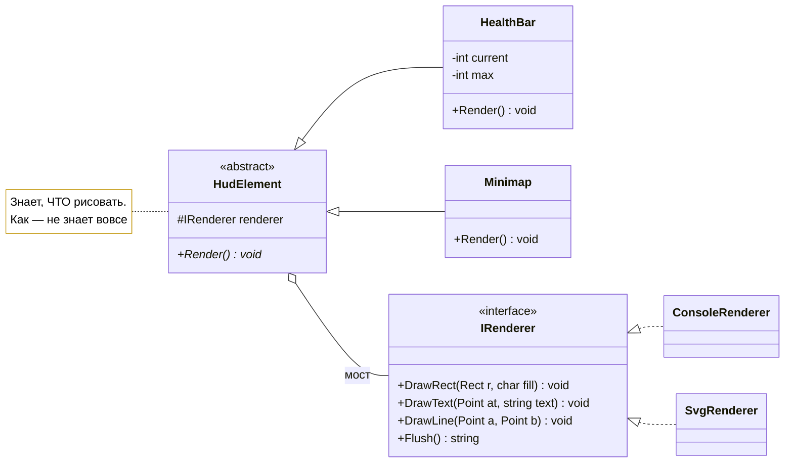

# Лабораторная работа 6. Мост: две иерархии вместо одной

!!! info "Об этом материале"

    Тема: структурный паттерн Мост — разделение абстракции и реализации на две независимые иерархии.
    Объём: 6–8 часов; сдаётся репозиторием с коммитами по этапам и отчётом.
    Оценка: 100 баллов плюс до 4 за задания со звёздочкой; штрафы указаны в тексте.

> Тема: структурный паттерн Bridge — разделение абстракции и реализации, борьба
> с комбинаторным взрывом классов, подмена реализации во время выполнения.
> Язык — **C#**, диаграммы — **Mermaid**. Ориентировочно 6–8 часов.

## Цель работы

Увидеть на собственном коде, как наследование по двум осям даёт произведение классов,
и заменить его двумя независимыми иерархиями. Плюс понять, в чём мост принципиально
отличается от адаптера из прошлой работы — при почти одинаковых диаграммах.

Главная проектная задача этой работы не в том, чтобы написать мост, а в том, чтобы
**выбрать правильный набор примитивов** для интерфейса реализации. Это сложнее,
чем кажется, и именно за это я буду спрашивать на защите.

## Легенда

У игры есть интерфейс: полоска здоровья, миникарта, окно диалога, панель инвентаря.
И есть несколько способов это нарисовать:

- **в консоли** — ASCII-псевдографикой, для отладки и серверной сборки;
- **в SVG** — для документации, скриншотов и отчётов;
- **в HTML/Canvas** — для веб-версии.

Элементов интерфейса — четыре, способов рисования — три. Наследованием это даёт
двенадцать классов, и каждый новый элемент добавляет три, а каждый новый способ
рисования — четыре.

---

## Этап 0. Разминка: посчитать взрыв (30 минут)

Заготовка проекта лежит в материалах курса:
<https://github.com/radilov-spsu/materials/tree/main/OOP/examples/HudBridge> —
решение `HudBridge.sln`, консольное приложение, иерархия элементов интерфейса
и проект тестов на xUnit. Как её забрать, написано там же в README. Скопируйте папку
к себе, проверьте, что `dotnet run` и `dotnet test` отрабатывают, — и это ваш первый
коммит, до единой собственной правки.

В заготовке интерфейс сделан «в лоб» — наследованием по двум осям:

```csharp
public abstract class HudElement { public abstract void Render(); }

public class ConsoleHealthBar : HudElement { public override void Render() { /* ASCII */ } }
public class SvgHealthBar     : HudElement { public override void Render() { /* SVG  */ } }
public class ConsoleMinimap   : HudElement { public override void Render() { /* ASCII */ } }
public class SvgMinimap       : HudElement { public override void Render() { /* SVG  */ } }
// ...и так далее
```

**Что сделать:**

1. Посчитать классы в заготовке. Записать формулу: при `N` элементов интерфейса
   и `M` способов рисования — сколько классов нужно?
2. Заполнить таблицу для своего варианта: сколько классов сейчас; сколько станет
   при добавлении одного элемента; при добавлении одного способа рисования;
   при добавлении обоих.
3. Найти **дублирование**: откройте `ConsoleHealthBar` и `SvgHealthBar`. Что в них
   одинаково, а что различается? Выпишите по пунктам — это и есть будущая граница
   между абстракцией и реализацией.

---

## Этап 1. Построить мост (2,5 часа)

Разделите одну иерархию на две: **что рисуем** и **чем рисуем**.



??? note "Исходник диаграммы"

    ```
    classDiagram
        direction LR
        class HudElement {
            <<abstract>>
            #IRenderer renderer
            +Render()* void
        }
        class HealthBar {
            -int current
            -int max
            +Render() void
        }
        class Minimap {
            +Render() void
        }
        class IRenderer {
            <<interface>>
            +DrawRect(Rect r, char fill) void
            +DrawText(Point at, string text) void
            +DrawLine(Point a, Point b) void
            +Flush() string
        }
        class ConsoleRenderer
        class SvgRenderer
        HudElement <|-- HealthBar
        HudElement <|-- Minimap
        IRenderer <|.. ConsoleRenderer
        IRenderer <|.. SvgRenderer
        HudElement o-- IRenderer : мост
        note for HudElement "Знает, ЧТО рисовать.<br/>Как — не знает вовсе"
    ```

**Требования:**

- две иерархии, связанные композицией: реализация приходит в конструктор абстракции;
- в классах элементов интерфейса **нет ни одного** упоминания консоли, SVG или HTML —
  проверяется поиском по проекту;
- в реализациях нет ни слова про здоровье, карту и инвентарь — они знают только примитивы;
- минимум **три** элемента интерфейса и **две** реализации;
- тест: один и тот же элемент, отрисованный двумя реализациями, даёт два разных
  результата с одинаковой структурой (например, в обоих есть текст с числом здоровья).

### Главный вопрос этапа: какие примитивы?

Интерфейс реализации — это ваше проектное решение, и у него две крайности:

- **слишком мелкие примитивы** (`SetPixel`) — реализацию написать легко, но каждый
  элемент интерфейса вынужден рисовать прямоугольник сам, и это дублируется;
- **слишком крупные** (`DrawHealthBar`) — реализация знает про предметную область,
  и при добавлении нового элемента придётся править **все** реализации. Мост выродился.

**В отчёт:** приведите свой набор примитивов и обоснуйте каждый. Покажите по одному
примеру того, что вы отвергли как слишком мелкое и как слишком крупное, и объясните,
к чему бы это привело.

---

## Этап 2. Доказать независимость осей (1,5 часа)

Два коммита, каждый со своим доказательством.

**Коммит А: новый элемент интерфейса.** Добавьте панель инвентаря. Ни один файл
реализации не должен измениться.

**Коммит Б: новая реализация.** Добавьте третий способ рисования (HTML/Canvas,
Markdown-таблица, Mermaid-диаграмма — по варианту). Ни один файл абстракции
не должен измениться.

**Требования:**

- к каждому коммиту приложить `git diff --stat` в отчёт;
- в диффе коммита А — только новые файлы и точка сборки; в диффе коммита Б — только
  новая реализация и точка сборки;
- если какой-то файл всё же пришлось тронуть, **не прячьте это**: объясните, почему,
  и что в проекте примитивов оказалось неверно. Честный разбор здесь оценивается выше,
  чем подогнанный результат.

Сравните с этапом 0: сколько классов добавилось бы там и сколько добавилось здесь.

---

## Этап 3. Подмена реализации в рантайме (1 час)

То, чего наследование не умеет в принципе: один и тот же объект меняет способ
отрисовки по ходу работы.

```csharp
var hud = new HealthBar(new ConsoleRenderer()) { Current = 42, Max = 100 };
hud.Render();                       // ASCII в консоль

hud.Renderer = new SvgRenderer();   // та же полоска, другой способ
hud.Render();                       // теперь SVG
```

**Требования:**

- смена реализации у живого объекта, без пересоздания;
- тест: состояние абстракции (текущее здоровье) при смене реализации **не теряется**;
- сценарий в `Program.cs`: собрать интерфейс один раз и выгрузить его в два формата
  подряд — на экран и в файл.

**Вопрос в отчёт:** почему в версии с этапа 0 так сделать нельзя? Ответ должен быть
про то, когда фиксируется связь: при компиляции или во время выполнения.

---

## Этап 4. Мост среди соседей (1 час)

| | Что разделяет | Когда применяют | Можно ли менять в рантайме |
|---|---|---|---|
| Мост | | | |
| Адаптер (лаб. 5) | | | |
| Стратегия | | | |
| Строитель GoF (лаб. 2) | | | |

Ответьте письменно:

1. **Мост и адаптер.** Диаграммы почти совпадают. Сформулируйте различие **в одном
   предложении**, через время принятия решения.
2. **Мост и стратегия.** У обоих объект делегирует работу подставленному объекту.
   В чём разница? (Ориентир: сколько операций в интерфейсе и есть ли у подставляемого
   собственная иерархия.)
3. **Мост и строитель из лабораторной 2.** Там тоже было «одно и то же содержимое,
   разные представления». Почему это всё-таки разные паттерны? Назовите, кто в каждом
   случае управляет порядком действий.

---

## Этап 5 (со звёздочкой)

+2 балла за пункт, максимум +4:

1. **Третья ось.** Добавьте тему оформления (светлая/тёмная). Покажите, во что это
   превратилось бы в иерархии этапа 0 (`N × M × K`), и как вы встроили её в мост —
   третьей иерархией или параметром реализации. Обоснуйте выбор.
2. **Реализация по умолчанию.** Сделайте так, чтобы абстракция сама выбирала реализацию,
   если её не передали (по платформе или по конфигурации). Это приём из книги — объясните,
   что он упрощает и какую зависимость добавляет.
3. **Мост + адаптер.** Подключите чужую библиотеку рисования как ещё одну реализацию
   через адаптер из лабораторной 5. Покажите на диаграмме оба паттерна и объясните,
   какой из них здесь «изнутри», а какой «снаружи».
4. **Python-версия.** Соберите тот же мост на Python и покажите, что при утиной типизации
   интерфейс реализации можно не объявлять. Объясните, что вы при этом теряете.

---

## Варианты заданий

Вселенная — та же, что в прошлых работах. Различается, что рисуем и чем:

| № | Абстракции (минимум 3) | Реализации (минимум 2 + 1 на этапе 2) |
|---|---|---|
| 1 | полоска здоровья, миникарта, окно диалога, инвентарь | консоль, SVG, Markdown |
| 2 | сканер, панель навигации, список целей | консоль, SVG, HTML |
| 3 | индикатор взлома, карта сети, лог импланта | консоль, SVG, Mermaid |
| 4 | компас, карта течений, судовой журнал | консоль, SVG, Markdown |
| 5 | счётчик радиации, карта убежищ, рюкзак | консоль, SVG, HTML |
| 6 | манометр, схема цеха, список деталей | консоль, SVG, Mermaid |
| 7 | шкала осады, план крепости, список приказов | консоль, SVG, Markdown |
| 8 | датчик глубины, карта рифа, запас кислорода | консоль, SVG, HTML |
| 9 | термометр, карта маршрута, список припасов | консоль, SVG, Markdown |
| 10 | шкала благосклонности, карта мира, список даров | консоль, SVG, Mermaid |
| 11 | шкала заражения, карта района, аптечка | консоль, SVG, HTML |
| 12 | согласовать | согласовать |

Реализация в Mermaid — приятный бонус: её вывод вставляется прямо в отчёт и становится
картинкой.

---

## Что сдаётся

1. **Репозиторий** на основе [заготовки](https://github.com/radilov-spsu/materials/tree/main/OOP/examples/HudBridge); коммиты по этапам, для этапа 2 —
   **два отдельных** коммита с приложенными `git diff --stat`.
2. **Код**: приложение собирает интерфейс и выводит его в два формата подряд.
3. **Тесты** — минимум шесть: один элемент в двух реализациях; каждая реализация
   получает ожидаемые вызовы примитивов (подойдёт реализация-шпион); смена реализации
   в рантайме не теряет состояние; новый элемент работает со всеми реализациями;
   новая реализация работает со всеми элементами; некорректное состояние абстракции
   (здоровье больше максимума) отвергается.
4. **Отчёт** `README.md`: ответы на вопросы этапов 0–4, **диаграмма классов с обеими
   иерархиями**, обоснование набора примитивов, оба `git diff --stat`, таблица соседей,
   раздел «чем платим».

---

## Критерии оценки

| Что | Баллов |
|---|---|
| Этап 0: формула взрыва, таблица роста, разбор дублирования | 10 |
| Этап 1: две иерархии, чистое разделение, **обоснование примитивов** | 30 |
| Этап 2: два коммита с доказательством независимости осей | 20 |
| Этап 3: подмена реализации в рантайме с сохранением состояния | 10 |
| Тесты (6 обязательных) | 15 |
| Диаграмма и отчёт, включая таблицу соседей | 15 |
| **Итого** | **100** |
| Этап 5 со звёздочкой | +2 за пункт, максимум +4 |

**Штрафы:** упоминание формата вывода в классах абстракции — минус 15; примитив,
знающий предметную область (`DrawHealthBar`) — минус 15; изменённый файл чужой иерархии
в коммитах этапа 2 без объяснения — минус 10; диаграмма с одной иерархией — минус 5.

---

## Типичные ошибки

1. **Примитивы знают предметную область.** `IRenderer.DrawHealthBar(int hp)` — мост
   выродился: добавление элемента снова правит все реализации.
2. **Абстракция знает формат.** В `HealthBar` появился `if (renderer is SvgRenderer)` —
   разделение сломано, и это заодно нарушение принципа открытости/закрытости.
3. **Мост при одной реализации.** Если способ рисования один и второй не планируется,
   это теоретическая общность из лекции 2, а не мост.
4. **Реализация с состоянием абстракции.** Рендерер запомнил текущее здоровье —
   состояние уехало не в ту иерархию, и две абстракции на одном рендерере начнут мешать
   друг другу. Проверьте это тестом.
5. **Мост назван адаптером.** На защите спрашиваю в первую очередь.
6. **Копирование кода между реализациями.** Если `SvgRenderer` и `HtmlRenderer`
   совпадают на 80%, у реализаций тоже нужна своя иерархия или общий базовый класс.

---

## Контрольные вопросы

1. Какую задачу решает мост и какой формулой описывается проблема, которую он убирает?
2. Как вы выбирали примитивы интерфейса реализации? Что отвергли и почему?
3. Чем мост отличается от адаптера? Сформулируйте через время принятия решения.
4. Чем мост отличается от стратегии?
5. Почему в версии с наследованием нельзя сменить способ отрисовки в рантайме?
6. Где в .NET вы видели мост? (Ориентир: `ILogger` и провайдеры, `DbConnection`
   и драйверы.)

## Литература

- Конспект лекции 6, блок 3 «Bridge — мост».
- **Э. Гамма и др. Приёмы объектно-ориентированного проектирования**, глава 4, раздел
  «Мост»: пример с окнами и оконными системами (`Window` / `WindowImp`) — ровно ваша
  задача, только вместо элементов интерфейса там окна; отдельно прочитайте абзац
  о выборе правильного набора примитивов и о создании реализации по умолчанию.
- Документация .NET: `ILogger` и провайдеры логирования, `DbProviderFactory`
  и `DbConnection` — мост промышленного масштаба.
