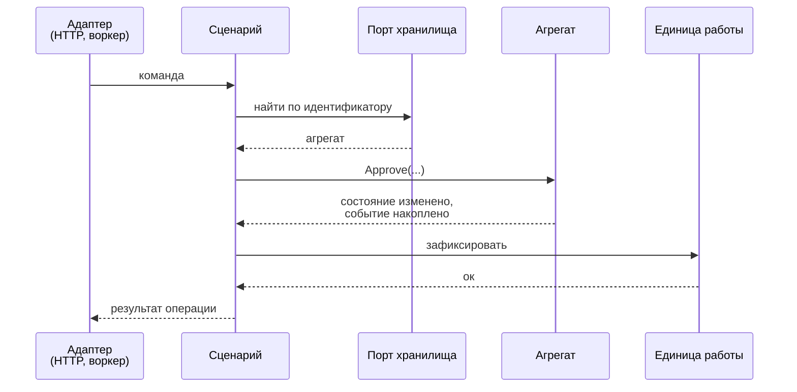
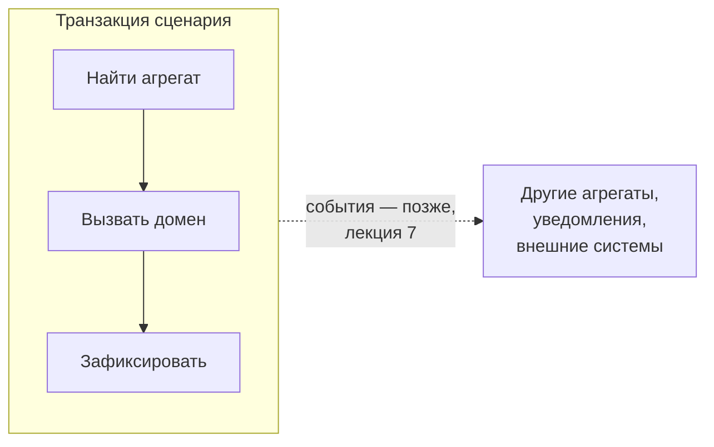

# ТП. Лекция 3 — Слой сценариев: прикладные службы, порты, транзакции

> Конспект лектора. После второй лекции у нас есть домен: агрегаты, которые защищают
> правила, и объекты-значения, которые не дают появиться неправильным данным. Но домен
> ничего не делает сам — его нужно найти, вызвать и сохранить результат. Этим занимается
> слой, который в нашем курсе называется слоем сценариев. Лекция опирается на главу 8
> Хононова («Архитектурные паттерны») и главу 14 Вернона («Приложение»), а трилемма,
> начатая в прошлый раз, здесь доводится до рабочего приёма. Лекция готовит к третьей
> лабораторной.

Глоссарий и таблица соответствия терминов в конце — раздаточный материал.

---

## Блок 1. Чего не умеет домен

### Что говорим

Возьмём метод `Approve` из прошлой лекции. Он проверяет `BR-04`, добавляет решение
в историю, двигает кандидатуру на следующий этап. Всё правильно — и совершенно
бесполезно само по себе, потому что кто-то должен:

- понять, что вообще нужно сделать и над чем;
- достать нужный агрегат оттуда, где он лежит;
- вызвать доменный метод;
- сохранить изменения так, чтобы они применились целиком или не применились вовсе;
- сообщить результат тому, кто просил.

Ни один из этих пунктов — не бизнес-правило. Это **координация**: порядок шагов,
границы транзакции, перевод между внешним миром и доменом. Домен ею заниматься
не должен, иначе он снова узнает про хранилище и про HTTP.

Значит, нужен слой между доменом и внешним миром. У него много имён, и это первая
сложность темы.

### Ключевая мысль блока

Домен отвечает на вопрос «что истинно всегда». Слой сценариев отвечает на вопрос
«что система умеет делать». Первый — набор правил, второй — набор операций.

---

## Блок 2. Прикладная служба и её граница

### Что говорим

Хононов цитирует определение Фаулера: сервисный слой определяет границу приложения,
устанавливает набор доступных действий и координирует реакцию приложения на каждое
действие. Вернон называет то же самое **прикладной службой** и даёт три утверждения,
которые стоит запомнить дословно:

- прикладные службы — **непосредственные клиенты модели предметной области**;
- они **ответственны за координацию потоков сценария использования**, причём один метод
  службы отвечает за один поток;
- при работе с транзакционной базой данных они **контролируют транзакции**, гарантируя
  атомарное сохранение переходов между состояниями модели; кроме того, обычно решают
  задачи безопасности.

И главное предупреждение Вернона: **сохраняйте прикладные службы тонкими**, используя их
только для координации задач в модели. Вся бизнес-логика должна быть перенесена
в домен — в агрегаты, объекты-значения или доменные сервисы.

### Терминология

Хононов приводит таблицу соответствия имён, и её полезно иметь перед глазами, потому
что в литературе один и тот же слой называется по-разному:

| У Хононова | Синонимы из других источников | В нашем курсе |
|---|---|---|
| слой представления | слой пользовательского интерфейса | Web API |
| сервисный слой | прикладной слой, Application Layer | слой сценариев |
| слой бизнес-логики | слой предметной области, слой модели | Domain |
| слой доступа к данным | слой инфраструктуры | Infrastructure |

Сам Хононов замечает, что предпочитает «слой пользовательского интерфейса» и «уровень
инфраструктуры», потому что эти термины лучше отражают обязанности современных систем
и не путаются с физическими границами сервисов. Отдельно он подчёркивает: сервисный
слой — **логическая граница**, а не физический сервис. Слово «сервис» здесь не имеет
отношения ни к микросервисам, ни к SOA.

### Когда этот слой не нужен

Честное замечание Хононова, которое стоит проговорить: если бизнес-логика реализована
транзакционным сценарием, то она **уже и есть** сервисный слой — набор методов,
образующих публичный интерфейс системы. Добавлять поверх него ещё один слой бессмысленно:
он будет повторять сигнатуры без всякого абстрагирования. Достаточно чего-то одного.

Слой сценариев окупается там, где за ним стоит модель предметной области, то есть у нас.

### Ловушка для студентов

Главный признак того, что слой поплыл: в сценарии появляется `if` про предметную область.
«Если кандидатура отклонена — вернуть ошибку» в обработчике означает, что правило `BR-04`
теперь живёт в двух местах, и однажды они разойдутся. Сценарий имеет право на проверки
другого рода — существует ли объект, есть ли права, — но не на бизнес-правила.

---

## Блок 3. Четыре шага сценария

### Что говорим

Почти любой сценарий, меняющий состояние, состоит из одних и тех же шагов:

1. **найти** — загрузить агрегат через порт;
2. **вызвать** — передать домену решение;
3. **зафиксировать** — завершить транзакцию;
4. **ответить** — вернуть минимум, нужный вызвавшему.

=== "C#"

    ```csharp
    public sealed class ApproveApplicationHandler(
        IApplicationRepository repository,
        IUnitOfWork unitOfWork,
        IClock clock) : ICommandHandler<ApproveApplication>
    {
        public async Task HandleAsync(ApproveApplication cmd, CancellationToken ct)
        {
            // 1. найти
            var application = await repository.FindAsync(cmd.ApplicationId, ct)
                ?? throw new NotFoundException(cmd.ApplicationId);

            // 2. вызвать — решение принимает домен, здесь нет ни одного бизнес-if
            application.Approve(cmd.Decider, clock);

            // 3. зафиксировать
            await unitOfWork.CommitAsync(ct);
        }
    }
    ```

=== "Go"

    ```go
    type ApproveApplicationHandler struct {
        repository ApplicationRepository
        unitOfWork UnitOfWork
        clock      Clock
    }

    func (h *ApproveApplicationHandler) Handle(ctx context.Context, cmd ApproveApplication) error {
        // 1. найти
        application, err := h.repository.Find(ctx, cmd.ApplicationID)
        if err != nil {
            return err
        }

        // 2. вызвать — решение принимает домен
        if err := application.Approve(cmd.Decider, h.clock); err != nil {
            return err
        }

        // 3. зафиксировать
        return h.unitOfWork.Commit(ctx)
    }
    ```

=== "Python"

    ```python
    class ApproveApplicationHandler:
        def __init__(self, repository: ApplicationRepository,
                     unit_of_work: UnitOfWork, clock: Clock) -> None:
            self._repository = repository
            self._unit_of_work = unit_of_work
            self._clock = clock

        async def handle(self, cmd: ApproveApplication) -> None:
            # 1. найти
            application = await self._repository.find(cmd.application_id)
            if application is None:
                raise NotFoundError(cmd.application_id)

            # 2. вызвать — решение принимает домен
            application.approve(cmd.decider, self._clock)

            # 3. зафиксировать
            await self._unit_of_work.commit()
    ```

Четвёртый шаг здесь пустой, и это намеренно: метод ничего не возвращает. Почему —
в блоке 7.

### Поток целиком



??? note "Исходник диаграммы"

    ```
    sequenceDiagram
      participant A as Адаптер<br/>(HTTP, воркер)
      participant H as Сценарий
      participant R as Порт хранилища
      participant D as Агрегат
      participant U as Единица работы

      A->>H: команда
      H->>R: найти по идентификатору
      R-->>H: агрегат
      H->>D: Approve(...)
      D-->>H: состояние изменено,<br/>событие накоплено
      H->>U: зафиксировать
      U-->>H: ок
      H-->>A: результат операции
    ```


Обратите внимание, что на этой диаграмме нет базы данных. Сценарий о ней не знает:
он разговаривает с портом, а кто за портом стоит — решается в композиционном корне.

### Ключевая мысль блока

Сценарий читается как пересказ: нашли, попросили домен, сохранили. Если его нельзя
пересказать одним предложением на языке предметной области — он делает слишком много.

### Ловушка для студентов

Сценарий, который «на всякий случай» загружает три агрегата и что-то в каждом меняет.
Правило из прошлой лекции никуда не делось: одна транзакция — один агрегат. Подробнее
в блоке 6.

---

## Блок 4. Команда как объект, сценарий как класс

### Что говорим

Параметры сценария можно передавать по отдельности, а можно собрать в объект. Вернон
описывает второй вариант так: **команда** — это, по сути, сериализованный вызов метода,
и, поскольку объект команды назван именем операции, он носит более явный характер.
Команда состоит из простых типов, а не из объектов модели, — её заполняют из формы
или из тела запроса.

=== "C#"

    ```csharp
    public sealed record ApproveApplication(
        ApplicationId ApplicationId,
        Decider Decider);
    ```

=== "Go"

    ```go
    type ApproveApplication struct {
        ApplicationID ApplicationID
        Decider       Decider
    }
    ```

=== "Python"

    ```python
    @dataclass(frozen=True)
    class ApproveApplication:
        application_id: ApplicationId
        decider: Decider
    ```

Вернон добавляет важное: команду можно не только передать методу службы, но и отправить
в очередь, чтобы выполнить позже **обработчиком команд**. Обработчик семантически
эквивалентен методу прикладной службы, но отделён от неё во времени. Для нас это ещё
один довод в пользу отдельного класса на сценарий: такой класс можно вызвать из HTTP
сегодня и из фонового воркера завтра, не трогая ни строчки.

### Один класс — один сценарий

У Вернона прикладная служба — это класс с несколькими методами, по методу на сценарий.
В нашем курсе правило строже: **один класс — один сценарий**. Причина практическая:
у службы с десятью методами конструктор собирает зависимости всех десяти, и тест
на один сценарий вынужден готовить девять лишних. Класс на сценарий зависит ровно
от того, что ему нужно, и это видно в его конструкторе.

Заодно это буква I из SOLID на уровне модуля: клиент не должен зависеть от методов,
которыми не пользуется.

### Ловушка для студентов

Команда — не DTO запроса. У тела HTTP-запроса своя жизнь: там строки, там версия
контракта, там может не быть идентификатора исполнителя, потому что он берётся
из токена. Команда собирается адаптером из запроса плюс контекста вызова. Если
команда — это ровно тело запроса, слой сценариев привязан к HTTP, и вызвать его
из воркера уже не получится.

---

## Блок 5. Порты: что объявляет слой сценариев

### Что говорим

Правило из первой лекции: порт объявляется там, где используется, а реализуется снаружи.
Теперь видно, где именно это «там» — в слое сценариев. Типичный набор портов нашего
проекта:

| Порт | Зачем | Кто реализует |
|---|---|---|
| репозиторий агрегата | найти и сохранить агрегат целиком | инфраструктура |
| единица работы | завершить транзакцию сценария | инфраструктура |
| часы | текущее время, проверяемое в тестах | инфраструктура |
| генератор идентификаторов | новые идентификаторы, проверяемые в тестах | инфраструктура |
| уведомления | сообщить человеку о событии | инфраструктура |
| хранилище файлов | резюме кандидата | инфраструктура |

=== "C#"

    ```csharp
    public interface IApplicationRepository
    {
        Task<JobApplication?> FindAsync(ApplicationId id, CancellationToken ct);
        Task AddAsync(JobApplication application, CancellationToken ct);
    }

    public interface IUnitOfWork
    {
        Task CommitAsync(CancellationToken ct);
    }

    public interface IClock
    {
        DateTimeOffset UtcNow { get; }
    }
    ```

=== "Go"

    ```go
    type ApplicationRepository interface {
        Find(ctx context.Context, id ApplicationID) (*JobApplication, error)
        Add(ctx context.Context, application *JobApplication) error
    }

    type UnitOfWork interface {
        Commit(ctx context.Context) error
    }

    type Clock interface {
        UtcNow() time.Time
    }
    ```

=== "Python"

    ```python
    class ApplicationRepository(Protocol):
        async def find(self, id: ApplicationId) -> JobApplication | None: ...
        async def add(self, application: JobApplication) -> None: ...

    class UnitOfWork(Protocol):
        async def commit(self) -> None: ...

    class Clock(Protocol):
        def utc_now(self) -> datetime: ...
    ```

### Порт называется на языке задачи, а не технологии

Это главное практическое правило блока. Сравните два имени одного и того же порта:

- `ISmtpClient` с методом `SendAsync(to, subject, body)`;
- `ICandidateNotifier` с методом `NotifyAdvancedAsync(application, stage)`.

Первое имя протащило технологию внутрь: сценарий теперь знает, что уведомление —
это письмо. Когда к письмам добавятся сообщения в мессенджер, менять придётся сценарий.
Второе имя говорит о задаче, и способ доставки остаётся снаружи.

Тот же критерий применим к репозиторию. Метод `FindByEmailAndVacancyAndStatusAsync` —
это SQL-запрос, переодетый в интерфейс. Метод `FindActiveForAsync(email, vacancy)` —
вопрос на языке предметной области.

### Порт вывода

Вернон описывает любопытный приём: прикладная служба **всегда объявляется пустой**
и ничего не возвращает клиенту, а результат пишет в **порт вывода** — именованный порт
на краю приложения, у которого может быть сколько угодно читателей-адаптеров,
по одному на тип клиента. Он сам отмечает, что подход затрудняет выбор имён для методов
запроса: метод `tenant()` перестаёт быть удачным именем, когда он ничего не возвращает,
и становится `findTenant()`.

Нам этот приём в проекте не понадобится, но знать его полезно: он показывает, что
«команда ничего не возвращает» — не каприз, а следствие того же стиля портов
и адаптеров. Вернон прямо сравнивает запись в порт вывода с чисто командным методом
агрегата, который не возвращает значения, но публикует событие предметной области.

### Ловушка для студентов

Порт, повторяющий API библиотеки. Если интерфейс репозитория принимает выражение-фильтр,
это не порт, а слегка переименованная ORM: вся гибкость чужого инструмента просочилась
в слой сценариев, и подменить его в тесте уже нельзя.

---

## Блок 6. Транзакционная граница

### Что говорим

Вернон говорит об этом прямо: прикладные службы контролируют транзакции, гарантируя
атомарное сохранение переходов между состояниями модели. Отсюда три следствия.

**Транзакция начинается и заканчивается в сценарии.** Не в контроллере, не в репозитории,
не в домене. Домен вообще не знает слова «транзакция»: он меняет состояние объекта
в памяти, а сохранится это или нет — не его забота.

**Один сценарий — одна транзакция — один агрегат.** Правило из прошлой лекции здесь
получает исполнителя. Если сценарию нужно атомарно изменить два агрегата, это не повод
открыть транзакцию пошире, это повод вернуться к границам: либо они проведены неверно,
либо второе изменение должно произойти позже, через событие. Как именно — лекция 7.

**Единица работы** (unit of work) — порт, за которым прячется механизм фиксации.
Сценарий не вызывает `Save` у каждого изменённого объекта: он просит зафиксировать
всё, что накопилось. Репозиторий при этом отвечает за поиск и за добавление новых
агрегатов, а за сохранение изменений уже найденного — единица работы.



??? note "Исходник диаграммы"

    ```
    flowchart LR
      subgraph TX["Транзакция сценария"]
        L["Найти агрегат"] --> C["Вызвать домен"] --> S["Зафиксировать"]
      end
      TX -.->|"события — позже,<br/>лекция 7"| E["Другие агрегаты,<br/>уведомления,<br/>внешние системы"]
    ```


### Что делать с уведомлениями

Третья лабораторная ставит этот вопрос ребром. Сценарий одобрил кандидатуру — надо
уведомить (`FR-21`, `FR-22`). Отправить письмо прямо здесь, после `Commit`?

Нет, и мы это уже обсуждали в первой лекции на антипримере: отправка упала — решение
принято, но никто не узнал; транзакция откатилась после отправки — письмо ушло о том,
чего не было. Правильный ответ — события и гарантированная доставка, то есть лекция 7
и седьмая лабораторная. До тех пор в третьей работе уведомление вызывается через порт
сразу после фиксации, с явным комментарием, что это временное решение, и с записью
в ADR. Это честнее, чем сделать вид, что проблемы нет.

### Ловушка для студентов

Транзакция, растянутая на весь HTTP-запрос через фильтр или middleware. Выглядит
удобно, а на деле: в транзакции оказываются чтения, которым она не нужна; длительность
транзакции определяется скоростью сериализации ответа; и главное — граница транзакции
перестаёт быть видимой в коде сценария.

---

## Блок 7. Команды и запросы

### Что говорим

Операции системы делятся на два вида, и они устроены по-разному.

**Команда** меняет состояние. Она проходит через агрегат, потому что только агрегат знает
правила. Возвращать ей нечего — максимум идентификатор созданного объекта. Именно поэтому
в блоке 3 метод объявлен без результата.

**Запрос** ничего не меняет. И вот здесь неожиданное: запросу агрегат не нужен. Хуже того,
агрегат ему мешает. `FR-12` требует список кандидатур по вакансии с фильтром и сортировкой;
если тянуть его через репозиторий агрегатов, мы поднимем в память сотни полных объектов
со всей историей решений — ради того, чтобы показать десять строк таблицы.

Хононов описывает это как **разделение ответственности команд и запросов**, CQRS,
и выделяет два типа моделей: модель выполнения команд и модели чтения. Модель выполнения
команд — единственная модель, представляющая строго непротиворечивые данные, источник
истины; она реализует бизнес-логику, проверку правил и инвариантов. Модели чтения —
проекции, доступные только для чтения: ни одна операция системы не может менять их
напрямую.

Полный CQRS с отдельными хранилищами и проекциями нам не нужен, но принцип мы берём
в упрощённом виде:

| | Команда | Запрос |
|---|---|---|
| Меняет состояние | да | нет |
| Идёт через агрегат | обязательно | нет |
| Что возвращает | ничего или идентификатор | DTO, собранный под экран |
| Где проверяются правила | в домене | правил нет |
| Транзакция | на запись | только чтение |

=== "C#"

    ```csharp
    // Запрос не трогает домен: он сразу собирает то, что нужно показать
    public interface IApplicationQueries
    {
        Task<PagedResult<ApplicationListItem>> ListAsync(
            VacancyId vacancy, StageFilter filter, Page page, CancellationToken ct);
    }

    public sealed record ApplicationListItem(
        Guid Id, string CandidateName, string CurrentStage, DateTimeOffset AppliedAt);
    ```

=== "Go"

    ```go
    // Запрос не трогает домен: он сразу собирает то, что нужно показать
    type ApplicationQueries interface {
        List(ctx context.Context, vacancy VacancyID,
            filter StageFilter, page Page) (PagedResult[ApplicationListItem], error)
    }

    type ApplicationListItem struct {
        ID            uuid.UUID
        CandidateName string
        CurrentStage  string
        AppliedAt     time.Time
    }
    ```

=== "Python"

    ```python
    # Запрос не трогает домен: он сразу собирает то, что нужно показать
    class ApplicationQueries(Protocol):
        async def list(self, vacancy: VacancyId, filter: StageFilter,
                       page: Page) -> PagedResult["ApplicationListItem"]: ...

    @dataclass(frozen=True)
    class ApplicationListItem:
        id: UUID
        candidate_name: str
        current_stage: str
        applied_at: datetime
    ```

### Ключевая мысль блока

Правило зависимостей для запросов не ослаблено: порт запросов по-прежнему объявлен
в слое сценариев, реализация — снаружи. Ослаблено другое — запрос не обязан идти через
домен, потому что ему нечего защищать.

### Ловушка для студентов

Обратное искушение — сделать «универсальный» запрос, возвращающий всё про кандидатуру,
и использовать его везде. Тогда каждый экран тянет данные девяти других, а изменение
одного экрана ломает остальные. DTO собирается под конкретный сценарий чтения,
и дублирование полей между ними — нормально.

---

## Блок 8. Конвейер обработки

### Что говорим

Во всех сценариях повторяется одно и то же: проверить входные данные, проверить права,
записать в журнал, открыть и закрыть транзакцию. Копировать это в каждый обработчик —
значит однажды где-то забыть.

Решение — **конвейер**: обработчик оборачивается слоями, каждый из которых делает одну
вещь и передаёт управление дальше. Это шаблон «Декоратор» из ООАП, применённый к сценарию.

<figure style="margin:1.6em 0; text-align:center">
<svg viewBox="0 0 700 300" role="img" aria-label="Конвейер обработки: команда проходит через вложенные слои — проверку входных данных, проверку прав, журналирование и транзакцию — и достигает обработчика сценария, который вызывает домен" style="width:100%; max-width:700px; height:auto; font-family:var(--sans)">
<rect x="70" y="18" width="560" height="264" rx="10" fill="none" stroke="var(--accent)" stroke-width="1.5"/>
<text x="350" y="38" text-anchor="middle" font-size="13" font-weight="600" fill="var(--ink)">Проверка входных данных</text>
<rect x="100" y="48" width="500" height="204" rx="9" fill="none" stroke="var(--accent)" stroke-width="1.5"/>
<text x="350" y="68" text-anchor="middle" font-size="13" font-weight="600" fill="var(--ink)">Проверка прав · AC-01</text>
<rect x="130" y="78" width="440" height="144" rx="8" fill="none" stroke="var(--accent)" stroke-width="1.5"/>
<text x="350" y="98" text-anchor="middle" font-size="13" font-weight="600" fill="var(--ink)">Журналирование · идентификатор запроса</text>
<rect x="160" y="108" width="380" height="84" rx="7" fill="var(--accent-soft)" stroke="var(--accent)" stroke-width="1.5"/>
<text x="350" y="128" text-anchor="middle" font-size="13" font-weight="600" fill="var(--ink)">Транзакция</text>
<rect x="196" y="138" width="308" height="40" rx="6" fill="var(--accent)" stroke="var(--accent)"/>
<text x="350" y="155" text-anchor="middle" font-size="13.5" font-weight="600" fill="var(--panel)">Обработчик сценария</text>
<text x="350" y="171" text-anchor="middle" font-size="11.5" fill="var(--panel)">найти · вызвать домен · зафиксировать</text>
<line x1="8" y1="150" x2="62" y2="150" stroke="var(--ink-soft)" stroke-width="2"/>
<polygon points="62,144 76,150 62,156" fill="var(--ink-soft)"/>
<text x="10" y="140" font-size="12" fill="var(--ink-soft)">команда</text>
<line x1="638" y1="150" x2="692" y2="150" stroke="var(--ink-soft)" stroke-width="2"/>
<polygon points="638,144 624,150 638,156" fill="var(--ink-soft)"/>
<text x="690" y="140" text-anchor="end" font-size="12" fill="var(--ink-soft)">результат</text>
<text x="350" y="272" text-anchor="middle" font-size="11.5" font-style="italic" fill="var(--ink-faint)">снаружи внутрь: чем дороже слой, тем позже он включается</text>
</svg>
<figcaption style="font-size:13px; color:var(--ink-faint); margin-top:4px">Каждый слой оборачивает следующий: управление проходит внутрь и возвращается тем же путём наружу</figcaption>
</figure>

Порядок здесь не произволен. Проверка входных данных идёт первой: бессмысленно открывать
транзакцию ради команды, в которой не заполнено обязательное поле. Права проверяются
до транзакции, но после разбора команды. Журналирование охватывает всё, чтобы в записи
попали и отказы. Транзакция — самый внутренний слой, чтобы она была как можно короче.

### Что в конвейер класть нельзя

Бизнес-правила. Соблазн велик: «проверка, что кандидатура не отклонена, нужна в трёх
сценариях — вынесу в конвейер». После этого правило `BR-04` живёт в инфраструктурном
коде, его не видно в домене, и доменный тест его не поймает. Конвейер — для того,
что одинаково для **всех** сценариев и не зависит от предметной области.

Разница проверок, которую стоит проговорить: проверка входных данных отвечает на вопрос
«команда вообще осмысленна» (идентификатор не пустой, причина не длиннее лимита поля),
а бизнес-правило — на вопрос «допустима ли эта операция сейчас». Первое — в конвейере,
второе — в домене.

### Ловушка для студентов

Конвейер из восьми слоёв на проекте с пятью сценариями. Каждый слой — это ещё один
прыжок в отладчике и ещё одна вещь, которую нужно объяснить на защите. Начните
с транзакции и журналирования, остальное добавляйте, когда повторение станет реальным.

---

## Блок 9. Трилемма на практике

### Что говорим

В прошлой лекции мы разобрали трилемму Хорикова: полнота модели, чистота модели
и производительность — одновременно только две. Наша архитектура закрыла вариант
«домен сам ходит в хранилище», значит выбор идёт между «загрузить всё заранее»
и «разделить решение». Теперь посмотрим, как второй вариант выглядит в коде.

Правило `BR-02`: у одного адреса почты не может быть двух одновременно активных
кандидатур на одну вакансию.

```csharp
public sealed class SubmitApplicationHandler(
    IApplicationRepository repository,
    IUnitOfWork unitOfWork,
    IClock clock) : ICommandHandler<SubmitApplication>
{
    public async Task HandleAsync(SubmitApplication cmd, CancellationToken ct)
    {
        // BR-02, часть правила: сам факт наличия активной кандидатуры
        // домен выяснить не может — у него нет доступа к хранилищу.
        // Проверка здесь, окончательная гарантия — ограничение в БД (лекция 4).
        var active = await repository.FindActiveForAsync(cmd.Email, cmd.VacancyId, ct);
        if (active is not null)
            throw new BusinessRuleViolation("BR-02", "active candidacy already exists");

        var application = JobApplication.Submit(cmd.Email, cmd.VacancyId, clock);
        await repository.AddAsync(application, ct);
        await unitOfWork.CommitAsync(ct);
    }
}
```

Три вещи в этом коде важнее самого кода.

**Часть правила уехала из домена, и это отмечено явно.** Не комментарием «проверка»,
а указанием номера правила и причины, по которой проверка здесь. Через полгода читатель
поймёт, что это не небрежность, а решение.

**Исключение несёт номер правила.** `BusinessRuleViolation("BR-02", …)` — не просто
текст: именно отсюда возьмётся поле `code` в ответе API, которого требует раздел 9.4 ТЗ.
Правило, расщеплённое между слоями, снаружи выглядит одинаково.

**Проверка в сценарии не является гарантией.** Два отклика, пришедшие одновременно,
оба пройдут эту проверку, прежде чем любой из них сохранится. Окончательно `BR-02`
защищает уникальный индекс в хранилище — лекция 4. Сценарий даёт понятное сообщение
об ошибке в обычном случае; хранилище даёт гарантию в гонке.

### Как это фиксировать

Любое расщеплённое правило попадает в ADR: какой вариант трилеммы выбран, почему,
и что было бы, если выбрать другой. И покрывается тестом сценария — потому что
доменный тест до него уже не дотянется.

### Ловушка для студентов

Расщепить правило молча. Через месяц кто-то добавит второй способ подать отклик —
импорт, админку, фоновую задачу — и `BR-02` там просто не будет. Отмеченное решение
живёт в двух местах; неотмеченное — в одном из них исчезает.

---

## Блок 10. Тест-даблы

### Что говорим

Домен мы тестировали вообще без подмен. Сценарий так не протестируешь: ему нужны
репозиторий, часы, единица работы. Значит, нужны **тест-дубли**, и важно различать их виды
(терминология Мезароса, из первой лекции):

| Вид | Что делает | Когда уместен |
|---|---|---|
| **стаб** | возвращает заранее заданный ответ | «репозиторий вернёт вот эту кандидатуру» |
| **мок** | проверяет факт и параметры вызова | «убедиться, что уведомление отправлено один раз» |
| **фейк** | рабочая, но упрощённая реализация | репозиторий в памяти на словаре |

Главное правило блока: **домен в тестах сценариев настоящий**. Подменяются только порты.
Если в тесте сценария вы подменяете агрегат, вы проверяете, что код вызывает методы
в нужном порядке, — а это не поведение, а реализация.

=== "C#"

    ```csharp
    [Fact]
    public async Task BR_02_second_active_application_is_rejected()
    {
        var repository = new InMemoryApplicationRepository();   // фейк
        await repository.AddAsync(ApplicationBuilder.ActiveFor("ivan@mail.ru", Vacancy.Id), Ct);
        var handler = new SubmitApplicationHandler(repository, new NoopUnitOfWork(), FixedClock.Default);

        var act = () => handler.HandleAsync(new SubmitApplication("ivan@mail.ru", Vacancy.Id), Ct);

        (await act.Should().ThrowAsync<BusinessRuleViolation>()).Which.Code.Should().Be("BR-02");
    }
    ```

=== "Go"

    ```go
    func TestBR02_SecondActiveApplicationIsRejected(t *testing.T) {
        repository := fakes.NewInMemoryApplicationRepository()   // фейк
        repository.Add(ctx, builders.ActiveApplicationFor("ivan@mail.ru", vacancyID))
        handler := NewSubmitApplicationHandler(repository, fakes.NoopUnitOfWork{}, fakes.FixedClock{})

        err := handler.Handle(ctx, SubmitApplication{Email: "ivan@mail.ru", VacancyID: vacancyID})

        var violation *BusinessRuleViolation
        require.ErrorAs(t, err, &violation)
        require.Equal(t, "BR-02", violation.Code)
    }
    ```

=== "Python"

    ```python
    async def test_br_02_second_active_application_is_rejected():
        repository = InMemoryApplicationRepository()             # фейк
        await repository.add(active_application_for("ivan@mail.ru", vacancy_id))
        handler = SubmitApplicationHandler(repository, NoopUnitOfWork(), FixedClock())

        with pytest.raises(BusinessRuleViolation) as error:
            await handler.handle(SubmitApplication("ivan@mail.ru", vacancy_id))

        assert error.value.code == "BR-02"
    ```

### Ключевая мысль блока

Фейк почти всегда лучше мока. Тест с фейком читается как сценарий: в системе была
активная кандидатура, пришёл второй отклик, его отвергли. Тест с моками читается
как список ожиданий к вызовам и ломается при любом рефакторинге, даже если поведение
не изменилось.

---

## Итоги лекции

1. Домен отвечает, что истинно всегда; слой сценариев — что система умеет делать.
2. Прикладная служба координирует поток сценария, контролирует транзакцию и остаётся тонкой.
3. Сценарий — это четыре шага: найти, вызвать домен, зафиксировать, ответить.
4. Бизнес-`if` в сценарии означает, что правило утекло из домена.
5. Команда — именованный объект операции из простых типов; один класс на сценарий.
6. Порты объявляются в слое сценариев и называются на языке задачи, а не технологии.
7. Транзакция начинается и заканчивается в сценарии; одна транзакция — один агрегат.
8. Команда идёт через агрегат и ничего не возвращает; запрос не идёт через домен и возвращает DTO под экран.
9. Конвейер — для того, что одинаково во всех сценариях; бизнес-правилам там не место.
10. Расщеплённое по трилемме правило отмечается явно, несёт номер правила наружу и покрывается тестом сценария.
11. В тестах сценариев домен настоящий, подменяются только порты; фейк обычно лучше мока.

Одна фраза на всю лекцию: **сценарий ничего не решает — он только расставляет
по порядку тех, кто решает.**

---

## Глоссарий (раздаточный материал)

| Термин | Определение | Источник |
|---|---|---|
| **Единица работы** | Порт, фиксирующий все изменения сценария одной операцией | Фаулер; Вернон, гл. 14 |
| **Запрос** | Операция, которая читает состояние и не меняет его | Хононов, гл. 8 |
| **Класс-сценарий** | Класс, реализующий ровно один сценарий использования | правило курса |
| **Команда** | Объект, названный именем операции, из простых типов; сериализованный вызов метода | Вернон, гл. 14 |
| **Конвейер обработки** | Цепочка слоёв вокруг обработчика: проверка, права, журнал, транзакция | практика; «Декоратор» из GoF |
| **Модель выполнения команд** | Единственная строго согласованная модель, источник истины | Хононов, гл. 8 |
| **Модель чтения** | Проекция только для чтения, которую операции не меняют напрямую | Хононов, гл. 8 |
| **Обработчик команд** | Исполнитель команды, семантически равный методу службы, но отделённый во времени | Вернон, гл. 14 |
| **Порт вывода** | Именованный порт, в который служба пишет результат вместо возврата значения | Вернон, гл. 14 |
| **Прикладная служба** | Непосредственный клиент модели предметной области, координирующий поток сценария | Вернон, гл. 14 |
| **Сервисный слой** | Слой, определяющий границу приложения и набор доступных действий | Фаулер; Хононов, гл. 8 |
| **CQRS** | Разделение ответственности команд и запросов на разные модели | Хононов, гл. 8 |
| **DTO** | Объект передачи данных через границу слоя | Вернон, гл. 14 |

### Соответствие терминов

| Оригинал | Хононов | Вернон | В курсе |
|---|---|---|---|
| Application Service | прикладной слой, сервисный слой | прикладная служба | сценарий, обработчик сценария |
| Application Layer | сервисный слой | уровень приложения | слой сценариев |
| Unit of Work | — | единица работы | единица работы |
| Command | команда | команда | команда |
| Command Handler | — | обработчик команд | обработчик сценария |
| Read Model | модель чтения | — | модель чтения |
| Data Transfer Object | — | объект передачи данных | DTO |
| Data Transformer | — | преобразователь данных | — |
| Output Port | — | порт вывода | порт вывода |

---

## Вопросы для самопроверки

1. Назовите три утверждения Вернона о прикладных службах.
2. Почему Хононов говорит, что при транзакционном сценарии отдельный сервисный слой не нужен?
3. Перечислите четыре шага сценария. Какой из них в командах обычно пуст и почему?
4. Чем команда отличается от DTO тела HTTP-запроса? Что сломается, если их объединить?
5. Почему в курсе принято «один класс — один сценарий», хотя у Вернона служба имеет много методов?
6. Сравните имена `ISmtpClient` и `ICandidateNotifier`. Что меняется при добавлении второго канала доставки?
7. Где начинается и где заканчивается транзакция? Почему не в контроллере?
8. Почему запросу не нужен агрегат? Что произойдёт с `FR-12`, если тянуть список через репозиторий агрегатов?
9. Что можно и чего нельзя класть в конвейер обработки? Приведите по примеру.
10. Чем проверка входных данных отличается от проверки бизнес-правила?
11. Правило расщеплено между сценарием и хранилищем. Как это должно быть видно в коде, в ответе API и в документации?
12. Почему проверка `BR-02` в сценарии не является гарантией? Что даёт гарантию?
13. Почему в тестах сценариев домен настоящий? Что проверяет тест, в котором подменён агрегат?

## Домашнее задание

**Чтение.** Хононов, глава 8 — разделы «Слоистая архитектура» (включая «Сервисный слой»
и «Терминология») и «Разделение ответственности команд и запросов». Вернон, глава 14 —
раздел «Прикладные службы» целиком, включая «Не связанный вывод службы».

**Подготовка к третьей лабораторной.** Выпишите все сценарии из `FR-01` … `FR-19`
и для каждого укажите:

- команда это или запрос;
- какой агрегат он меняет — и убедитесь, что ровно один;
- какие порты ему нужны;
- есть ли у него правило, расщеплённое по трилемме.

Отдельным списком — сценарии, которые по вашим пометкам требуют изменить два агрегата.
С ними разберёмся на занятии: там либо ошибка в границах, либо кандидат на событие.

**Со звёздочкой.** Придумайте сценарий нашей системы, в котором порт вывода Вернона
был бы уместнее обычного возвращаемого значения. Объясните, что он дал бы и чем
пришлось бы заплатить.

## Литература

- Хононов В. Изучаем DDD — предметно-ориентированное проектирование. 2024.
  Глава 8 «Архитектурные паттерны».
- Вернон В. Реализация методов предметно-ориентированного проектирования.
  Глава 4 «Архитектура», глава 14 «Приложение».
- Fowler M. Patterns of Enterprise Application Architecture. 2002. Service Layer, Unit of Work.
- Khorikov V. Domain model purity vs. domain model completeness (DDD Trilemma). 2020.
